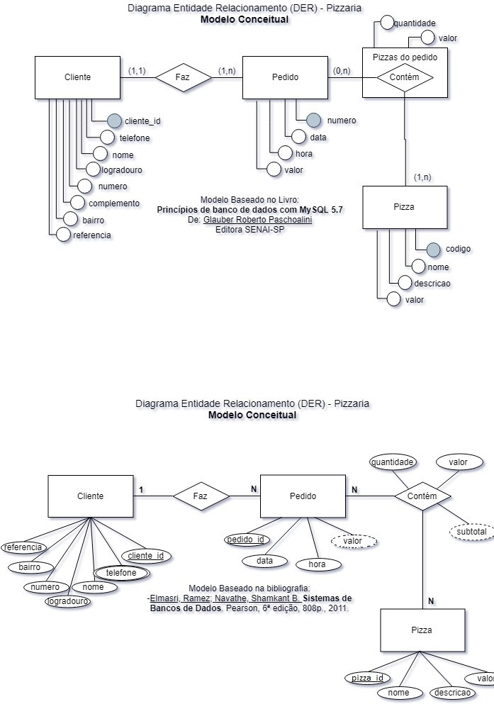

# Sistema de Pedidos de Pizzaria — Consultas SQL

## Descrição
Atividade prática de banco de dados com o objetivo de cadastrar clientes, gerenciar pedidos, consultar produtos e atualizar informações utilizando comandos SQL.

## Modelo do banco de dados

## Atividades desenvolvidas

### 1. Cadastro de cliente
Inserção de um novo cliente na tabela `clientes`, contendo nome, endereço, número, bairro, referência e telefone.

### 2. Registro de pedidos
Criação de pedidos vinculados aos clientes cadastrados, utilizando a chave estrangeira `cliente_id`.

### 3. Consulta de pedidos
Utilização de comandos `select` e `inner join` para relacionar as tabelas:
- `clientes`
- `pedidos`
- `itens_pedido`
- `pizzas`

### 4. Relatório de pedidos
Criação de consultas para apresentar:
- Número do pedido;
- Nome do cliente;
- Nome das pizzas;
- Quantidade de cada pizza;
- Subtotal por item.

### 5. Cálculos e agrupamentos
Utilização das funções `sum()` e `count()`, juntamente com `group by`, para calcular o valor total dos pedidos e contabilizar as pizzas.

### 6. Cadastro de nova pizza
Inclusão da pizza **A moda do chef** no cardápio, com sua descrição e preço de R$ 41,90.

### 7. Registro e alteração de pedido
Registro de um pedido para o cliente Gaspar Oliveira, inicialmente com duas pizzas A moda do chef.

Posteriormente, o pedido foi atualizado conforme a solicitação do cliente:
- Quantidade de A moda do chef alterada de 2 para 3 unidades;
- Inclusão de 1 pizza Margherita.

## Tecnologias utilizadas
- MySQL
- SQL
- MySQL Workbench

## Comandos SQL utilizados
- `insert into`: inserção de registros;
- `select`: consulta de dados;
- `inner join`: relacionamento entre tabelas;
- `update`: atualização de registros;
- `sum()`: cálculo de valores e quantidades;
- `count()`: contagem de registros;
- `group by`: agrupamento de resultados;
- `create view`: criação de visualizações;
- `create index`: criação de índices.

